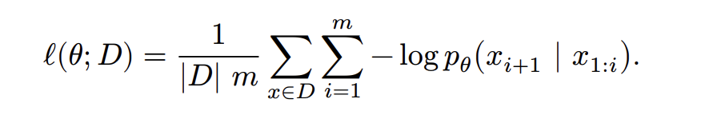
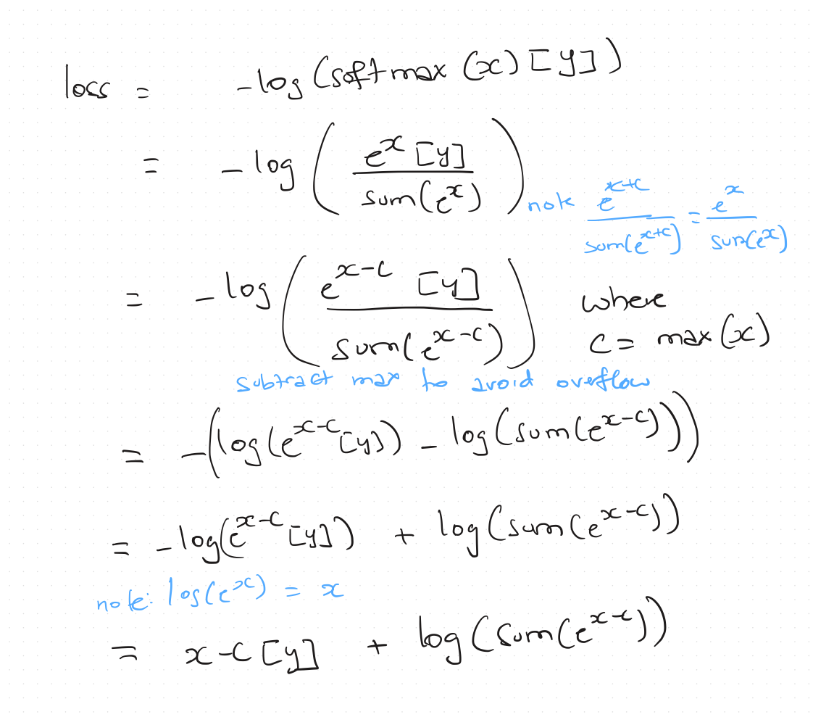
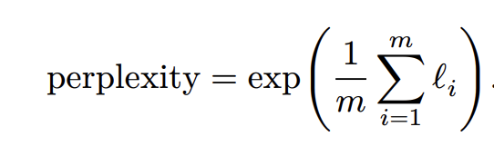
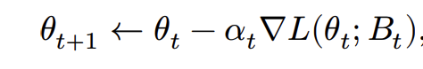
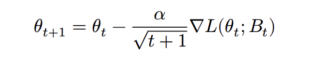
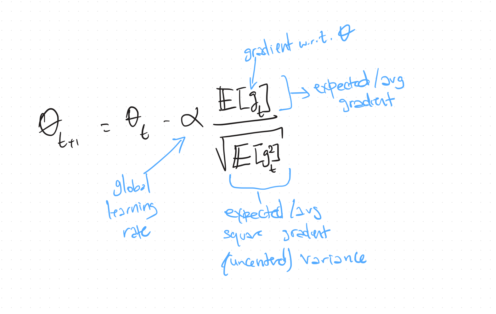
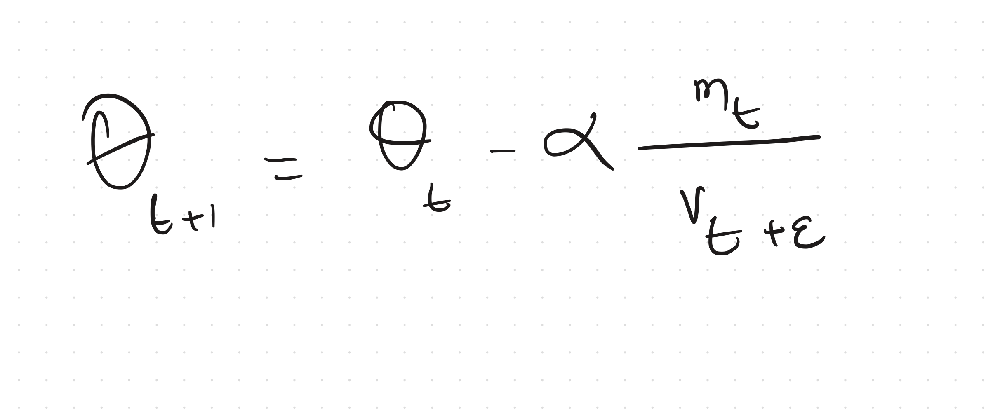
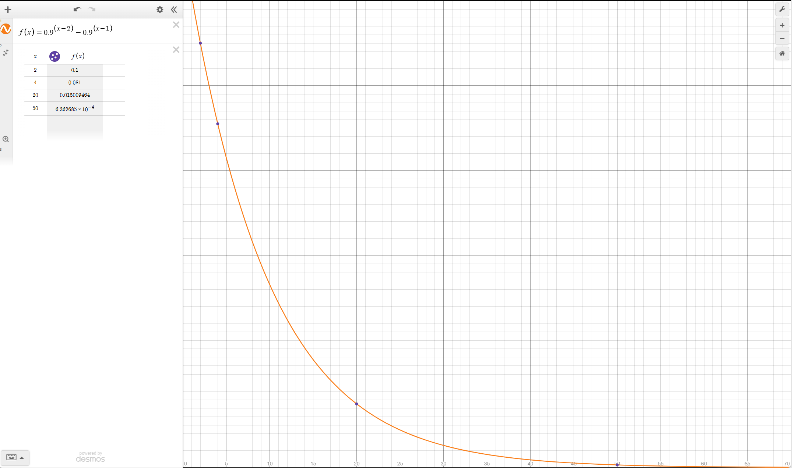
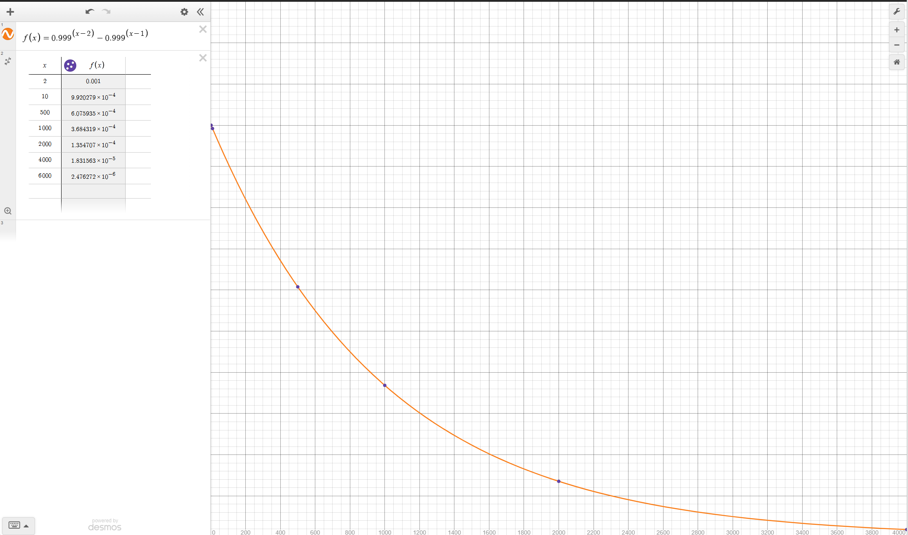

# 4. Training a Transformer LM

We now have the steps to preprocess the data (via tokenizer) and the model (Transformer). What 
remains is to build all of the code to support training. This consists of the following:

- **Loss**: we need to define the loss function (cross-entropy).
- **Optimizer**: we need to define the optimizer to minimize this loss (AdamW).
- **Training loop**: we need all the supporting infrastructure that loads data, saves checkpoints, and 
manages training.

## 4.1. Cross-entropy loss

I found the following videos by 3Blue1Brown timely in providing some intuitition behind entropy, cross-entropy
and why cross-entropy is used as loss function for language models:

- [Reinventing Entropy](https://www.youtube.com/watch?v=l6DKRf-fAAM)
- [But what is cross-entropy](https://www.youtube.com/watch?v=GlYgs6v2YfU)

The homework instruction defines the standard cross-entropy loss (negative log-likelihood) as follows:



But instead of me just copying and implementing it blindly, I want to see whether I can use intuition and what I learned
from the 3Blue1Brown videos above to derive the loss formula from first principles.

Note that in some cases I may give hand-wavy, somewhat watered-down, explanations based on intuition.
Remember to consult the 3Blue1Brown videos and/or other sources for more rigorous and satisfying
explanations.

**Recap of Information Content, Entropy and Cross-Entropy**

Let's say we can construct messages from a vocabulary of symbols, where the probability of a symbol
appearing in the message is defined by the probability distribution P, i.e. `P[i]` is the probability
of symbol `i`.

Intuitively, the higher the probability of a symbol, the less we are surprised to see it in a message, similarly
the lower the probability, the more we are surprised to see it. The occurrence of low-probability event
provides more information than a high probabilty event, which is expected and easier to predict.

Intuitively, if we were to encode a message in binary and we want to minimize bit length (i.e. optimize compression),
it makes more sense to allocate more bits to less likely symbols, and fewer bits to more likely symbols. Since
the higher-probability symbols will be more frequent in the message, we should minimize their respective binary encoding
to minimize the average message size. This will lead to more efficient encoding (in terms of bytes allocated) than giving
each symbol the same number of bits. Conceptually, this is similar to how in BPE tokenization algorithm, we merge
the most frequent pairs into single tokens.

Now let's get into the maths a bit. It can be demonstrated that to optimize the compression of messages produced with
symbols based on some distribution P, the number of bits to allocate each symbol `i` should be `-log2(P[i])`. This
is considered the **Information content** of the symbol. An encoding based on this will lead to optimal compression.

Note that `-log2(P[i])` is equivalent to `log1/2(P[i])`, the number of times you have to chop something by half to get the probability.
It is a positive number that increases as `P[i]` decreases and is 0 when `P[i] == 1` (i.e. a symbol that is certain, constant doesn't
require any bits, such a message does not need to be transmitted since it's value is always known and never changes, transmitting it
is inherently redundant as it provides no new information).

And from this we can derive the average number of bits per symbol in a message M that uses symbols with distribution P,
i.e. the average information content of a message. This is just a weighted average of the number of bits per symbol,
where the weights are determined by the probabilities of each symbol. This is also called the **Entropy** and is
defined as:

```python
H(P) = -sum(P[i] * log2(P[i]))
```

Based on this, we expect that a message M using symbols based on distribution P, and using an optimal binary encoding
for that distribution will use on average `-sum(P[i] * log2(P[i]))` bits per symbol when measure over a large enough
sequence of symbols.

Note that the entropy assumes optimal encoding, i.e. an encoding that is optimized for distribution P, where
each symbol `i` is allocated bitlength based on `-log2(P[i])`. But what if we the symbols are based on a different distribution
`Q` but encoded using an encoding optimized for distribution `P`? Well, in this case we can use the **Cross-Entropy** to measure
the average bits per symbol of a message using an encoding optimized for distribution P, but where the symbols are actually
based on distribution Q:

```python
H(Q, P) = -sum(Q[i] * log2(P[i]))
```

The formula is similar to entropy, expect we use probabilities `Q[i]` for the weights since that represent the true distribution of the symbols,
but we use `log2(P[i])` for the bits per symbol since the encoding is based on P.

Now remember that an encoding based on `P` is optimal compression (minimizes average bit length) if the distribution of the symbols is also based on `P`. For other distributions, it will be sub-optimal. This means that `H(Q, P) == H(P)` if `Q == P` and `H(Q, P) > H(P)` when `Q != P`. The entropy `H(P)`
is the lower bound for the cross-entropy `H(Q, P)`, and this lowerbound is achieved when the two distributions are similar.

This means that the cross-entropy gives us a way to measure how similar the two distributions are. If the distribution Q is idential to P, then the
cross-entropy is minimized and is equivalent to the entropy of a message based on P.

**Application to language modelling**

Remember that a language model is not just predicting the next token, but generating a probability distribution for the next token (i.e. generating a probability for each possible token that can come next).

The task of the language model is to generate `P(next token | prefix)` for each possible token given some prefix sequence of tokens.
During training, we measure how well the generated probability distribution matches the underlying probability distribution of the training
dataset. And with a sufficiently large and well curated dataset, we want the distribution of the dataset is a good enough approximation
of the distribution of the language.

During training we want to use a loss function that is minimized when the model's output distribution matches the distribution of the training data,
and penalizes divergent distributions.

Now let's break it down to the level of training examples. During training we collect snippets from the training corpus where each
snippet is broken down into a prefix and target word/token. Let's take the following example of possible snippets that happen
to have the same prefix:

- I'm happy today
- I'm happy because
- I'm happy today
- I'm happy but
- I'm happy because
- I'm happy today
- I'm happy sometimes

If these are all occurrences of te prefix "I'm happy" in the training text, then the statistical distribution Q of the next
token based on the training data would be:

`P(next token| "I'm happy")` = [ Q_today: 0.43, Q_because: 0.29, Q_but: 0.14, Q_sometimes: 0.14]`.

Let's say the model outputs probability distribution P over the next token. For each example,
we use a loss function `f(x)` based on the output probability of the target token. The loss function
should penalize low probabilities of the expected target token (high loss) and reward high
probability of the target token.

So for the example "I'm happy -> today", we'll apply the loss function to the output probabilit P_today,
i.e. `f(P_today)`.

To get the average loss over all the training examples, we'll use a weighted average where the weight
of each loss will be based on the statistical probability of the target token in the training data:

```python
AverageLoss = sum(Q[i] * f(P[i]))
```

So what would be an appropriate loss function? Well for each example we want the loss to be minimized
when the probability of the target token is high (1), and the loss to be high when the output probability
of the target token is low. In addition, we want to average loss of all examples to be minimized
when the the output distribution of the target tokens matches the statistical distribution of the target tokens.
Specifically, the average loss should be minimized when the values of `P[i]` match the values of `Q[i]`.
We have already seen that the **cross-entropy** of P relative to Q matches this property, so cross-entropy
would be a good candidate for the average loss.

We can turn the formula above into cross-entropy by simply making the per-example loss function the negative log: `f(P[i]) == -log2(P[i])`.
As a result the average loss becomes the cross-entropy

```python
AverageLoss = sum(Q[i] * -log2(P[i])) = -sum(Q[i] * log2(P[i]))
```

Now there are many other possible per-example loss functions that have a similar shape as negative log (e.g. high when target probability is low, low
when target probability is high). The 2nd 3Blue1Brown video goes into more detail about why using a logarithm-based function is the ideal
option, I didn't get in the fine mathematical details.

For a single training example, we can consider that Q[target_token] == 1, i.e. in the snippet "I am happy today". Q(today | I am happy) is 1,
since that is the target token for that example, every other possible next token has prob 0.
So if only have a single example, the cross-entropy would be `-sum(Q[i] * log2(P[i]))`, since all `Q[i]` are 0 expect for `Q[target]`, most
terms will be eliminate leaving only `-Q[target] * log2(P[target])` = `- 1 * log2(P[target])` = `-log2(P[target])`. This is another
way to see how we can get from cross-entropy to the loss function.

Note that in deep learning we normally use `ln` (natural logarithm) instead of `log2` for the cross-entropy formula since `ln` is more
convenient to work with during gradient descent (since `d/dx ln(x) = 1/x`).

**Deriving training loss**

Now we know we'll use cross-entropy loss, we also know the per-example loss is `-log(P[target_token])`. Now we need to
apply this to the actual training process.

We'll be training one batch of data at a time. Each batch will have `B` sequences of `context_length` tokens.

I single sequence of size `m` will produce `m-1` training examples, e.g.

The sequence "I am happy today" will produce the following examples (assuming each word is a separate token):

Prefix | Target
-------|---------
I | am
I am | happy
I am happy | today

So for a sequence `x` of size `m + 1`, we'll produce `m` training examples.

In each example, the prefix is the range `x[1:i]` (inclusive) and the target is `x[i + 1]`, where
`i` goes from 1 to `m`.

The model will produce probability the distribution `P(V[k] | x[1:i])` where `x[1:i]` is the sequence of tokens from 1 to i (inclusive).
`V` is the vocabulary vector and `k` goes from 1 to `vocab_size`.

The loss function for this specific example is is based probability assigned to the target token `x[i + 1]`.

So the loss for the example is 

```python
LossForSingleExample =  -log(P(x[i + 1] | x[1:i]))
```

Now the average loss for all `m` training examples in the source sequence `x` will be:

```python
AverageLossForExamplesInSequence(x) = (1/m) * sum(-log(P(x[i + 1] | x[1:i])) for i in range(m))
```

Since we'll be training for each sequence in the training set, we need to get the average loss
over the entire data set (or in this case the batch, since we're doing mini batch gradient descent).
So we'll just aggregate the average of the loss above by the size of the dataset or batch:

```python
AverageLoss = (1/len(dataset)) * sum(AverageLossForExamplesInSequence(x) for x in dataset)
```

```python
AverageLoss = (1/len(dataset)) * sum((1/m) * sum(-log(P(x[i + 1] | x[1:i])) for i in range(m)) for x in dataset)
```

We can extract that `1/m` constant factor out of the outer summation to get:

```python
AverageLoss = (1/len(dataset)) * (1/m) * sum(sum(-log(P(x[i + 1] | x[1:i])) for i in range(m)) for x in dataset)
```

And this is equivalent to the original loss function formula in the instructions


Now remember that the transformer architecture we implement outputs unnormalized logits in the final
layer. The output layer has dimension `context_length * vocab_size` (i.e. output vector of vocab size for each of the context-length sequences),
assigning an unnormalized weight to each possible
token in the vocabulary. We turn these unnormalized weights in a probablity distribution using `softmax`:

```python
P[x[i + 1] | x[1:i]] = softmax(O[i])[x[i + 1]] = (e**O[i][x[i + 1]]) / sum(e**O[i][j] for j in range(vocab_size))
```

Where `O[i]` is the output vocab-sized vector correspoding to the training sequence `x[1:i]`, whose target output is the token `x[i + 1]

### 4.1.a Implementing cross-entropy loss

Implementing the cross-entropy loss requires some care with numerical issues, just like in the case of 
`softmax`.

> **Deliverable**: Write a function to compute the cross-entropy loss, which takes in predicted logits `o[i]`
> and targets `x[i + 1]` and computes the cross-entropy `l[i] = -log * softmax(o[i])[x[i + 1]]`.
> Your function should handle the following:
>
> - Subtract the largest element for numerical stability
> - Cancel out `log` and `exp` whenever possible
> - Handle any additional batch dimensions and return the average loss across the batch. As with section 3.2 we assume batch-like dimensions always come first, before the vocabulary size dimension.
>
> Implement`adapters.run_cross_entropy`, then run `uv run pytest -k test_cross_entropy` to 
> test your implementation.

Based on the hints above, we can transform the `-log * softmax(o[i])[x[i + 1]]` for better numerical stability, avoid over and underflows.

Here's the expanded version of the formula:



```python
exps = exp(o[i])
l[i] = -log * ((exps[x[i + 1]]) / sum(exps[j] for j in range(vocab_size)))
```

First, like in softmax, we can subtract the largest values (review `softmax` implementation to see why this works):

```python
exps = exp(o[i] - max(o[i]))
l[i] = -log((exps[x[i + 1]]) / sum(exps[j] for j in range(vocab_size)))
```

Now, remember the logarithmic identity `log(a / b) = log(a) - log(b)`. We can use
this to transform the formula above to:

```python
l[i] = - (log(exps[x[i + 1]]) - log(sum(exps)))
# which turns to
l[i] = -log(exps[x[i + 1]]) + log(sum(exps)))
```

Since `log(e**x) == x`, we can cancel out the `log` and `exp` in the first term. We can't
really simplify the second term though since it's a log of sums (and not a log of products).

```python
l[i] = -x[i + 1] + log(sum(exps))
```

### 4.1.b Perplexity

Cross-entropy suffices for training, but when we evaluate the model, we also want to report perplexity. 
For a sequence of length `m` where we suffer cross-entropy losses `l_1`, `l_2`, ..., `l_m`:



Basically, perplexity is the exponentiated average cross-entropy loss across our tokens.
We can also think of it as:

```python
perplexity(x, y) = exp(cross_entropy(x, y))
```

But what does this mean, why do we exponeniate the average cross-entropy/negative-likelihood loss?
Well an increase and decrease in cross_entropy also increases or decreases perplexity respectively,
but at different scales. It's harder to get an intuition of differnet cross-entropy values because
comparing logarithms is not very intuitive for humans. Perplexity "undoes" the logarithm
to make the loss easier to interpret, transforming the loss from a logarithm scale to a linear scale.


Intuitively, perplexity measures the performance of a model based on how confused it is.
Mathematically, it's also equivalent to the inverse of the probability assigned to the correct next token. It
tells how likely it was to pick the correct token based on a compressed number of choices.

Mathematically

Let `P` be the probability assigned to the correct next token by the model:

```python
H = -ln(P)
PPL = exp(H) = exp(-ln(P)) = 1/(exp(ln(P))) = 1/P
```


Let's take the following example:

The model assigns a 10% `0.1`probability to the correct
next token.

The cross-entropy loss `l = -log(0.1)` is  `2.3026`.

The perplexity is `exp(2.3026)` which is equivalent to `1/0.1` which is `10`.

A perplexity of 10 means the correct token had a 1/10 chance of being picked.
It tells you the model is guessing as if it were choosing between 10 equally likely options.

So if the vocab has 50,000 tokens, a perplexity of 10 means the model is performign really well.
A random guess would have a perplexity of 50,000.By achieving a perplexity of 10,
the model has used context to compress a massive dictionary of 50,000 possibilities down to a tiny
shortlist of just 10 realistic options.

A perplexity of 1, means the model is always certain of the next token.

A logarithmic scale compresses huge differences into small numbers. Small changes in cross-entropy
loss represent massive changes in how smart the model is. By exponentiating the loss, perplexity
undoes the that compression and converts the logarithmic scale back into a standard, linear scale.

Let's say Model A has a cross-entropy loss of 4.6 and Model B has a cross-entropy loss of 3.0.
The 1.6 difference may seem deceptly small. But the perplexity of A is 100 and B is 20. This
makes it clear to see that B is 5x more capable.

## 4.2. The SGD Optimizer

Next, we begin exploring optimizers. Optimizers update the value of learnable parameters based on the loss. A gradient-based optimizer
updates each parameter based on the gradient of the loss with respect to the parameter.

The simplest gradient based optimizer is Stochastic Gradient Descent (SGD). We start with randomly initialized parameters `theta[0]`.
Then for each step *t = 0, ..., T-1*, we perform the following update:

```python
theta[t + 1] = theta[t] - alpha[t] * gradient(loss(theta[t], B[t]))
```



Where:
- `B[t]` is a random batch of data sampled from the dataset D
- `alpha` is the learning rate

The learning rate and batch size are hyperparameters.

### 4.2.1 Implement SGD in PyTorch.

To demonstrate the `Optimizer` API in PyTorch (base class used to implement custom optimizer), we implement
a modified variant of SGD where the learning rate decays over time based on the formula:



I've implement this optimizer in [`sgd_optim_example.py`](./sgd_optim_example.py).

#### Learning rate tuning

> As we will see, one of the hyperparameters that affects training the most is the learning rate.
> Let’s see that in practice in our toy example. Run the SGD example above with three other values 
> for the learning rate: 1e1, 1e2, and 1e3, for just 10 training iterations. What happens with the loss
> for each of these learning rates? Does it decay faster, slower, or does it diverge (i.e., increase over 
> the course of training)?
>
> **Deliverable**: A one-to-two sentence response with the behaviors you observed

To answer this questions, I added the scenarios to `sgd_optim_example.py`, then run as:

```sh
uv run python -m cs336_basics.sgd_optim_example
```

```sh
Running training loop with LR=1 and num iterations=10
22.424942016601562
21.536914825439453
20.932065963745117
20.45145034790039
20.04446792602539
19.687503814697266
19.367321014404297
19.075620651245117
18.806804656982422
18.556882858276367
Done.

Running training loop with LR=10.0 and num iterations=10
25.632505416870117
16.404802322387695
12.092920303344727
9.461418151855469
7.663748741149902
6.3541259765625
5.358862400054932
4.579300880432129
3.9545862674713135
3.4448840618133545
Done.

Running training loop with LR=100.0 and num iterations=10
29.442251205444336
29.442249298095703
5.0514912605285645
0.12089355289936066
2.01826404930104e-16
2.249480452710394e-18
7.574792075885271e-20
4.512355867594862e-21
3.8709906965819494e-22
4.301100949282367e-23
Done.

Running training loop with LR=1000.0 and num iterations=10
23.219282150268555
8382.1611328125
1447731.25
161044608.0
13044613120.0
823264477184.0
42263702929408.0
1818365404381184.0
6.702107057350246e+16
2.1521211131680522e+18
Done.
```

Answer:

When learning rate is 1e1 the loss decays much faster than with lr=1. When lr is 1e2,  the loss quickly decays
to near 0 then starts to oscillate erratically above the minimum. When lr is 1e3 the loss diverges to very large values.

## 4.3 AdamW Optimizer

AdamW is a stateful optimizer that keeps track of running estimates of the first and second moments for each parameter.
Before implementing it, I'm curious to understand the rationale behind the evolution from SGD to AdamW and
the optimizer's algorithm.

AdamW is one of a number of adapative optimizer algorithms, we can trace the evolution from **SGD** -> **SGD with momentum** -> **AdaGrad** -> **RMSProp** -> **Adam** -> **AdamW**.

Standard SGD uses the same learning rate to update all parameters. And at each time step
SGD uses only the current gradient to determine the magnitude and direction of the update. SGD with momentum combines the current
gradient with a running velocity based on previous gradients.

**SGD**:

```python
param[t + 1] = param[t] - learning_rate * gradient[t]
```

**SGD with momentum**:

```python
v[t] = beta * v[t - 1] + gradient[t]
param[t + 1] = param[t] - learning_rate * v[t]
```


The other algorithms are a bit more complex but are also based on the idea
of maintaining state across timesteps and adjusting how each parameter is updated instead of relying only on the current gradient
and a global learning rate. Adam aims to combine the benefits of AdaGrad and RMSProp, and AdamW is a variant of Adam that makes weight decay more
effective. So I'll start with with a review of the Adam optimization algorithm.

### 4.3.1 Adam optimizer

**Source: [Adam: A method for stochastic optimization, 2015](https://arxiv.org/pdf/1412.6980)**

The name Adam is derived from "adapative moment estimation". It was proposed as a method for "efficient" stochastic optimization
that only requires first-order gradients (i.e. first derivatives only, no need for 2nd or higher derivatives) with "little memory
requirement". Note that here the "little memory requirement" is relative to approaches that computer higher-order derivatives. Adam
stores extra state for each parameter, so it requires O(n) memory with respect to model parameter count, so this is definitely less efficient
than standard SGD. But consider efficient compares to methods with require quadratic memory for example.

The Adam optimization algorithm has the following goals/benefits:

- Support for online and stochastic environments: i.e. loss function is not computed against entire dataset at once, but one at a time, or in minibatches
- Support for noisy objective functions: noise might be due to the fact that objective function is computed on different batches of data, or inherent to the function itself
- Support for non-stationary data: the distribution of the data might change across batches of data (i.e. mean, variance, and other characteristics of the dataset may change from on batch to the other)
- Robust to noisy and sparse gradients: should adapt to sudden gradient spikes, should adapt to cases where gradient is 0 most of the time
- Robust to gradient rescaling: if step size is directly proportional to gradient (like in SDG), then a sudden scaling factor of the gradient can cause the optimizer to take massive,
    exploding steps in parameter space, making paramter updates unstable and ruining training. Sensitivy to gradient scale also means changing something seemingly unrelated, like scaling the loss function or batch size, forces you to retune learning rate from scratch.

In short, Adam aims to adapt to a chaotic optimization problem while still being relatively computationally efficient.

It computes adaptive learning rates for each parameter from estimates of the first and second moments of the 
gradients. The first moment refers to the mean (mean of g) and the second moment to the variance (mean of g**2) 
(in this case uncentered variance since the mean is not subtracted from the squared gradients like in "standard" variance).
Adam doesn't compute the actual mean and variance, which would require storing the full history of gradients and would be inefficient, but only estimates using the last computed value.

The following is my attempt at deriving the Adam formula from my understanding.

Let's review the SGD update rule again: `param[t + 1] = param[t] - lr * g[t]`.

As mentioned, the update only takes the current gradient value (adjusted by the learning rate) into account. This is prone
to noisy updates if the gradient is temporarily unstable (changes direction quickly). It's also sensitive to large changes
in the magnitude of the gradient.

Conceptually, Adam updates the parameter based on the average gradient, rather than just the current gradient. It also
normalizes the average gradient by the average magnitude of the gradient to reduce sensitivity to gradient's scale.



Conceptually, Adam is an approximation of `param[t + 1] = param[t] - lr * E(g[t])/sqrt(E(g[t]**2))`

E(g[t]) here means the expected gradient at timestep t. Or the average/mean of the gradient. Using
the average rather than the latest value of the gradient at timestep t, makes the updates more robust to noise
and sudden spikes.

E[g[t]**2] is the expected variance. As meantioned before, we use the uncentered variance here. This estimates
the average maginute or "size" of the gradient values (note that gradient values can be positive or negative, but magnitude is always positive).
We use this normalize/divide the scale of the average gradient. Since the gradient is linear, and variance is squared, we take the
square root of the variance to bring it to the same scale as the average gradient so the division can be stable. This normalization
by the variance makes the updates more robust to gradient rescaling.

In machine learning optimization papers, we often use `m` to refer to the first moment, i.e. mean, and `v` to refer to the second
moment, i.e. variance.

```python
m = E(g)
v = E(g**2)
```

So we can rewrite the formula above as:

```python
param[t + 1] = param[t] - lr * m[t]/sqrt(v[t])
```

To prevent a 0 denominator when `v[t]` is 0, we can add a small neglibile value, epislon, for numerical stability:

```python
param[t + 1] = param[t] - lr * (m[t]/(sqrt(v[t]) + eps))
```



If we were to stop at this point, then we would have some level of resilience to noise and gradient rescaling, but what about sparse gradients, non-stationary data?
If the update is based on the global mean of all the data seen so far, then it means the current gradient has the same contribution to the mean as each gradient seen in the past.
This means the more data points and batches we visit, the smaller the impact of the latest gradient to the mean and therefore to the update. The oldest gradient
seen has just as much impact on the current update as the current mean. So the latest gradient may become relatively useless after seeing enough samples.
This would be fine if the gradient is mostly uniform or has a stable distribution across batches, but if the distribution changes or is too noisy/erratic, relying on the global
means the optimizer will not be able to adapt or will take too long to adapt to changes in distribution. If the data has sparse gradients, e.g. parameters in the model
that are activated by a unique data points that are relatively rare in the dataset, then the mean will be close to zero and a single non-zero gradient over multiple datapoints may not have enough
impact to tilt the mean enough for a meaninful update.

Adam addresses these concerns by using weighted averages instead of standard mean where every gradient has the same weight. Specifically, Adam uses exponential moving averages where
past gradient history decays exponentially. This allows the optimizer to recover from sparse gradients or adapt to changing distribution reasonably quickly, while still being reasonably
resilient to localized noise.

Instead of allocating past gradients individual weights, which would require us to store past gradients in memory, we use the following formulation which is more efficient estimate
for the exponetial moving average:

```python
m[t] = beta * m[t-1] + (1 - beta) * g[t]
```

Where `beta` is a value between [0-1]. This basically determines how much weight the current gradient has on the current parameter versus historical gradients. The closer beta is to 1,
the less affected it is by the current gradient and the smoother/less noisy m[t] is. The closer beta is to 0, the faster it can adapt to changes in distribution, sparsity, etc.

Note that each step, the weight a specific past gradient decays exponentially. To demonstrate this, let's track the weight of `g[2]` across of a few timesteps, assuming beta = 0.9.

At t = 2, `m2 = beta * m1 + (1 - beta) * g2`, the weight of `g2` is `1 - beta` = 0.1

At t = 3, `m3 = beta * m2 + (1 - beta) * g3` = `beta * (beta * m1 + (1 - beta) * g2) + (1 - beta) * g3`.
If we extract out `g2`, its weight is `beta * (1 - beta)` == `(beta - beta**2)` = `0.9 - 0.81` = `0.09`.

At t = 4, `m4 = beta * m3 + (1 - beta) * g4` = `beta * (beta * (beta * m1 + (1 - beta) * g2) + (1 - beta) * g3) + (1-beta) * g4`
Let's extract g2 from `beta * (beta * (beta * m1 + (1 - beta) * g2)`  = `beta * ((beta - beta**2))` = `beta**2 - beta**3` = (0.81 - 0.729) = 0.0081

The pattern is at t, g2's weight is `beta**(t-1) - beta**(t-2)`, so at t = 5, the weight is 0.0729.

 t | g2 weight
---|-----------
2  | 0.1
3  | 0.09
4  | 0.081
5  | 0.0729
10 | 0.03874
20 | 0.01351
50 | 0.000573

The weight decays slowly at first then eventually tapers off where it gets so close to 0 it's practically irrelevant to the current update.
With a starting weight of 0.1, the gradient still retains most of its weight in the next couple of time steps. The local neighbors
retain considerable influence to the current update compared to much older timesteps.



The exponential weighted average allows the optimizer to adapt to non-stationary data, noisy functions, sparse gradients, etc.

We'll also apply an exponential weight average to the variance, consequently we'll have beta_1 for the mean `m` and beta_2 for the variance `v`:

```python
m[t] = beta_1 * m[t-1] + (1 - beta_1) * g[t]
v[t] = beta_2 * v[t-1] + (1 - beta_2) * g[t]**2
```

Here's what the weights for `g2**2` look like when `beta_2 == 0.999`

 t    | g2 weight
------|-----------
2     | 0.001
10    | 0.00099
500   | 0.00061
1000  | 0.00037
2000  | 0.00014
4000  | 0.000018
6000  | 0.0000



Based on the update formula above, we can imagine the Adam algorithm to look as follow:

```python
def update_param(param, lr, beta_1, beta_2, eps, has_converged):
    m = 0
    v = 0
    for not has_converged()
        g = get_gradient(param)
        m = beta_1 * m + (1 - beta_1) * g
        v = beta_2 * m + (1 - beta_2) * (g**2)
        param.data -= lr * (m/(sqrt(v) + eps))

```

The Adam proposes as good defaults `lr = 0.001`, `beta_1 = 0.9` and `beta_2 = 0.999` and `eps = 10**-8`.
Note that `beta_2` is larger than `beta_1` by 2 orders of magnitude, this means individual variance has much lower
weight. Squaring gradients makes them much more noisy, small fluctuations in the gradient lead to much larger changes
in the variance (squared gradient). So we need a much small weight to keep a noisy spike from having too much influence
on future updates.

In statistics, there's a formula used to calculate the "center of mass" or effective lookback window of an exponential moving average:

```python
window_size = 1 / (1 - beta)
```

Conceptually, this tells how many steps really matter in influencing the average before the influence starts to taper off into irrelevance.

- For first moment, beta_2 = 0.9, 1/(1 - 0.9) = 10 steps
- For second moment, beta_2 = 0.999, 1 / (1 - 0.999) = 1000 steps

Adam tracks the gradient's *direction* over a short window that's quick to adapt to local twists and turns,
but tracks the *spread/variance* over a massive, ultra-smooth window. If `v` had a short memory (like 10 steps),
a single freak batch would cause `v[t]` to shoot straight up, and because `v[t]` lives in the denominator,
a sudden spike would crush the learning rate for the next several steps, freezing progress.
Therefore, the heavy smoothing ensures that `v[t]` acts as a stable, reliable denominator. It absorbs high-frequency
noise and only shifts slowly when the true underlying magnitude of the gradients changes over a long horizon.

We can also corroborate this by looking at the aggregate weight at 10 steps for b1 = 0.9 and 1000 steps at b2 = 0.999.

The aggregate weight of the last n timesteps can be computed by

```python
aggregate_weight_of_last_n_steps = lambda n: sum(beta**k * (1-beta) for k in range(0, n))
```

For beta1 = 0.9, n = 10 steps, the aggregate weight is 0.65

For beta2 = 0.999, n = 1000 steps, the aggregate weight is 0.63

The aggregate weights at the respective effective window sizes are almost the same value (0.65 and 0.63)

Now let's dive back to the algorithm we have so far:

```python
def update_param(param, lr, beta_1, beta_2, eps, has_converged):
    m = 0
    v = 0
    for not has_converged()
        g = get_gradient(param)
        m = beta_1 * m + (1 - beta_1) * g
        v = beta_2 * m + (1 - beta_2) * (g**2)
        param.data -= lr * (m/(sqrt(v) + eps))

```

This looks good in general based on everything we've discussed so far, however it has one critical issue.

Based on the formula `beta * m[t-1] + (1 - beta) * g1`, what we're trying to achieve is for 10% of the weight of the average to come from the current gradient, and 90% from past gradients.

However, we initialize `m` and `v` to 0, which means at `t_1`, we have `m[1] = beta_1 * 0 + (1 - beta_1) * g = (1 - beta_1) * g`, i.e. the first update has no history. Since the first
term is 0, `g_1` is the only gradient influence for the first step:

```python
m1 = 0.9 * 0 + 0.1 * g1 = 0.1g1
```

Now let's see the weight distribution between current and past gradients for the next couple of steps:

```python
m2 = 0.9 (0.1 * g1) + 0.1*g2 = 0.09g1 + 0.1g2

m3 = 0.9 (0.09g1 + 0.1g2) + 0.1g3 = 0.081g1 + 0.09g2 + 0.1g3 = 0.0171(past weights) + 0.1g3

m4 = 0.9 (0.171 + 0.1) + 0.1g4 = 0.2439(past weights) + 0.1g4

m5 = 0.9(0.2439 + 0.1) + 0.1g5 = 0.30951(past weights) + 0.1g5
```

In step 1, the weight of past gradients 0 and average is determined exclusively by the current gradient,
in subsequent steps the weight of the past gradient slowly starts to increase, but is still much lower than the expected 0.9.
This mean that the weight is more skewed towards the current gradient than we desire.
For example, at step 5 with 0.30951 as the aggregate weight of past gradients,
then the effective weights are actually 0.30951/(0.30951 + 0.1) and 0.1/(0.30951 + 0.1) which are 76% and 24% respectively.

So my question then is, after how many steps do we arrive at a steady state where the weight distribution is close
to the desired 90%-10% split between past gradients and current gradient.
